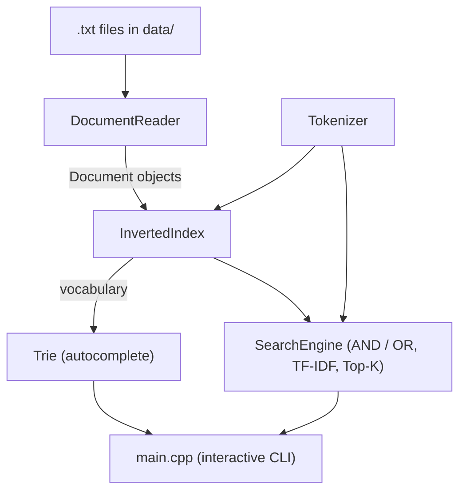
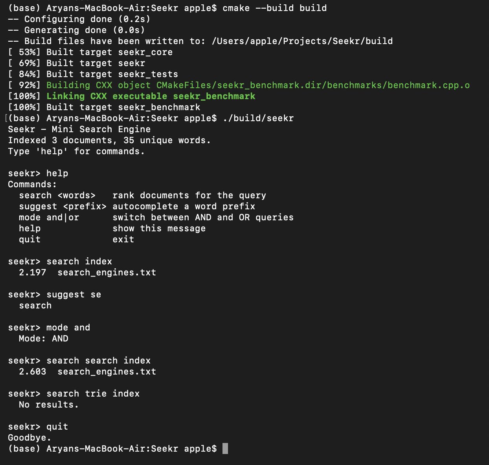
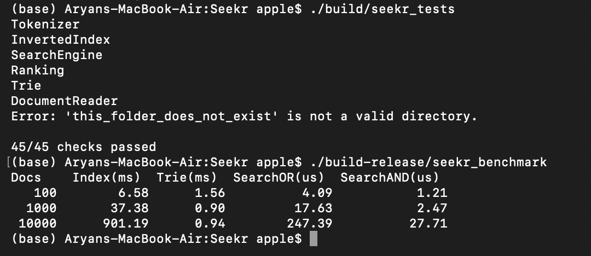

# Seekr: Mini Search Engine in C++17

A local document search engine that indexes `.txt` files and returns ranked results, built from scratch with the C++ standard library only (no external dependencies).
## Architecture




## Features
- **Document processing:** reads all `.txt` files in a directory, skips unreadable files and invalid directories
- **Tokenizer:** lowercases text and splits on punctuation
- **Inverted index:** `unordered_map<word, unordered_map<docId, termFrequency>>`
- **Search:** AND / OR keyword queries
- **Ranking:** TF-IDF scoring with Top-K selection using a `priority_queue` (min-heap)
- **Autocomplete:** Trie built from the index vocabulary
- **Tests:** custom test harness (45 checks)
- **Benchmark:** timing of indexing and search at 100, 1,000 and 10,000 documents

## Screenshots

**Interactive search session**



**Tests and benchmark**



## Ranking formula
```
TF(t, d)  = occurrences of term t in document d
IDF(t)    = ln(N / df(t))      N = total documents, df = documents containing t
score(d)  = sum over query terms of TF(t, d) x IDF(t)
```
Ties are broken by lower document ID.

## Build and run
Requires CMake 3.16+ and a C++17 compiler.

```bash
cmake -S . -B build
cmake --build build
./build/seekr            # indexes ./data
./build/seekr path/to/folder
```

Commands inside the program: `search <words>`, `suggest <prefix>`, `mode and|or`, `help`, `quit`.

## Run the tests
```bash
./build/seekr_tests
```

## Benchmark
```bash
cmake -S . -B build-release -DCMAKE_BUILD_TYPE=Release
cmake --build build-release
./build-release/seekr_benchmark
```

Measured on a MacBook Air (Apple Silicon), Release build, synthetic documents of 200 words each from a 5,000-word vocabulary (fixed seed 42):

| Docs | Index (ms) | Trie (ms) | Search OR (us) | Search AND (us) |
|---|---|---|---|---|
| 100 | 5.83 | 0.94 | 2.48 | 0.73 |
| 1,000 | 39.42 | 0.93 | 17.82 | 2.51 |
| 10,000 | 838.97 | 0.92 | 255.55 | 27.57 |

Search times are averages over 1,000 repeated queries of 3 terms, returning the top 5.

## Complexity
n = total words, D = documents, q = query words, P = largest postings list, K = results, L = word length.

| Operation | Time |
|---|---|
| Index build | O(n) average |
| Postings lookup | O(1) average |
| AND / OR search | O(q * P) |
| TF-IDF + Top-K | O(D' * q + D' log K) |
| Trie insert / prefix lookup | O(L) |

## Project structure
```
Seekr/
├── include/      headers
├── src/          implementation and main.cpp
├── tests/        test harness
├── benchmarks/   benchmark program
├── data/         sample documents
└── CMakeLists.txt
```

## Known limitations
- Tokenizer splits `don't` into `don` and `t`, and `c++17` into `c` and `17`
- `searchRanked` re-tokenizes the query after `search`, which repeats some work
- Entire index is held in memory

## Possible improvements
- Score during the first search pass
- Stemming and stop words
- Compressed Trie (radix tree)
- Persist the index to disk